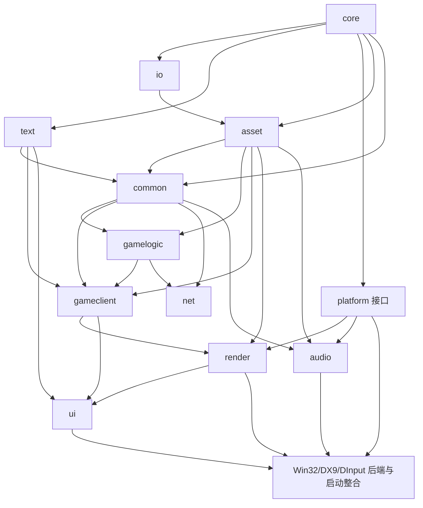

# RA3 模块映射、规模与重建顺序

本文以当前 `function_ledger.tsv` 和 `module_estimates.tsv` 为准。统计原始记录保存在
`docs/analysis/ra3_1.0/module_estimates_report.txt`，可由
`tools/analysis/attribute_modules.py` 确定性重建。

## 1. 口径与证据等级

基线包含 **48,985** 个 ledger 函数、**191** 条恢复源码路径、**2,977** 个虚表候选；
其中 **2,783** 个虚表至少有一个 ledger 方法，项目源码在 `.text` 中给出 **331**
个模块锚点 **[实测-账本]**。

标记约定：

- **[实测-账本]**：直接统计 ledger 或导出清单。
- **[实测-二进制]**：只读扫描 `ra3_1.0.game`。
- **[推断-虚表]**：同一候选虚表至少有两个不同的 ledger 锚点，且模块一致。
- **[推断-邻近]**：同一 `.text` 局部区间内最近的 ledger 锚点。
- **[参照]**：Generals/Zero Hour GPL 树的结构类比，不能证明 RA3 行为相同。

归属优先级是 `ledger → vtable → neighbor → unknown`。虚表只接受至少两个一致锚点；
出现多个模块便保留 `unknown`。邻近法把第三方锚点当边界，不向或越过
`thirdparty` 传播，也不进入 SecuROM 区段。等距锚点若模块不同，同样保留
`unknown`。

邻近窗口由工具在固定候选集上选择：取满足“至少 **20** 对相邻项目锚点且模块一致率
不低于 **90%**”的最大窗口。当前选择 **0x10000（64 KiB）**；该距离内相邻锚点
**203/221（91.9%）** 同模块。较近区间的累计结果为：

| 最大距离 | 同模块/总对数 | 一致率 |
|---:|---:|---:|
| `0x400` | 80/82 | 97.6% |
| `0x1000` | 132/138 | 95.7% |
| `0x4000` | 185/200 | 92.5% |
| `0x10000` | 203/221 | 91.9% |

这支持把 64 KiB 当保守的 `.obj` 局部上限，不证明整个窗口属于同一个对象文件。

直接调用数是在 `securom=clean` 的 `.text` ledger 函数范围内扫描 `E8 rel32` 并
解析到 ledger 入口得到的调用点数。本次识别 **123,661** 个调用点，命中
**21,998** 个目标 **[实测-二进制]**。它不计虚调用、函数指针、尾调用和导入
间接调用；扫描不是逐条反汇编，嵌入数据仍可能造成误报。

### 留出验证

工具以固定种子 `0x524133`，在每个有足够锚点的项目模块内随机留出 **20%**；
本次留出 **67** 个，训练锚点 **264** 个，评估窗口仍为 `0x10000`。精度的分母
只包含该方法实际给出预测的样本；`—` 表示该模块没有该方法的预测。

| 模块 | 留出数 | vtable 正确/预测（精度） | neighbor 正确/预测（精度） | 未预测 |
|---|---:|---:|---:|---:|
| `asset` | 2 | — | 1/2（50.0%） | 0 |
| `audio` | 1 | — | 1/1（100.0%） | 0 |
| `common` | 5 | — | 4/5（80.0%） | 0 |
| `core` | 3 | — | 3/3（100.0%） | 0 |
| `gameclient` | 6 | — | 4/4（100.0%） | 2 |
| `gamelogic` | 34 | — | 15/16（93.8%） | 18 |
| `io` | 6 | 4/4（100.0%） | 2/2（100.0%） | 0 |
| `net` | 4 | — | 3/3（100.0%） | 1 |
| `render` | 5 | — | 2/2（100.0%） | 3 |
| `ui` | 1 | — | — | 1 |
| **合计** | **67** | **4/4（100.0%）** | **35/38（92.1%）** | **25** |

样本很小，尤其 `asset`、`audio`、`ui`，不能把百分比解释成总体准确率。生产归属还
遇到 **964** 个虚表冲突函数、**7** 个邻居等距冲突和 **20,499** 个第三方边界阻断
函数；工具没有强猜。

## 2. 权威模块映射

Generals 路径默认相对于 `GeneralsMD\Code`。

| Ra3Source 模块 | RA3 恢复源码子树/证据 | Generals 对应目录 | 边界与状态 |
|---|---|---|---|
| `core` | `Libraries\Source\{ini,string,debug,memorypool}` | `Libraries\Source\...`、`GameEngine\Source\Common\System` | 配置、字符串、诊断、基础内存；已实现。 |
| `io` | `lib-packages\RtsBase\...\file`，以及 rw::core 文件系统证据 | `Common\System\ArchiveFile*`、`Win32Device\Common\Win32*File*` | 只读文件、BIG、RefPack；已实现。 |
| `text` | `GameEngine\gameclient\GameText.cpp` 与 `gamestrings.csf` | `GameClient\GameText.cpp` | CSF 与本地化查询；已实现，但当前 ledger 没有模块锚点。 |
| `asset` | `Libraries\Source\assetmanager`、`RtsXmlPipeline` | 无四件套直接同物 | `.manifest/.bin/.relo/.imp/.cdata`；里程碑已实现。 |
| `common` | `GameEngine\common` | `GameEngine\Source\Common` | 跨客户端和逻辑的共享领域类型。 |
| `gamelogic` | `GameEngine\gamelogic` | `GameEngine\Source\GameLogic` | 确定性模拟、对象、脚本与 AI。 |
| `gameclient` | `GameEngine\gameclient` | `GameEngine\Source\GameClient` | 非确定性表现、FX、粒子和输入语义。 |
| `net` | `GameEngine\gamenetwork` | `GameEngine\Source\GameNetwork` | 帧同步、命令流、传输和旧 GameSpy 边界。 |
| `render` | `GameEngineDevice\W3DDevice`、`SageRender` | `W3DDevice`、`WWVegas` | 渲染抽象、W3D 场景和 DX9 后端。 |
| `audio` | `GameEngineDevice\sageaudiodevice` 与 rw::audio 证据 | `Common\Audio`、`MilesAudioDevice` | 缓存、播放与设备后端；AudioEvent 描述留在 `common`。 |
| `ui` | `SageInGameUI` 与 Apt 导出证据 | `GameClient\GUI`、`InGameUI.cpp` | 游戏 UI 编排与 Apt 适配。 |
| `platform` | Win32/DInput/D3D 导入与窗口函数 | `Win32Device` | OS 接口和具体后端；当前没有 ledger 模块值。 |

非构建桶：`thirdparty` 有 **776** 行，`securom` 有 **7,429** 行，均不逐函数重建
**[实测-账本]**。原始 `unknown` 有 **40,449** 行；归属后仍有 **26,050** 行
**[实测-账本+推断]**。

## 3. 模块规模

| 模块 | ledger | vtable 新增 | neighbor 新增 | 估计总数 |
|---|---:|---:|---:|---:|
| `asset` | 9 | 0 | 952 | **961** |
| `audio` | 7 | 90 | 123 | **220** |
| `common` | 25 | 0 | 1,214 | **1,239** |
| `core` | 13 | 0 | 856 | **869** |
| `gameclient` | 28 | 0 | 1,261 | **1,289** |
| `gamelogic` | 170 | 98 | 6,937 | **7,205** |
| `io` | 31 | 29 | 421 | **481** |
| `net` | 21 | 0 | 1,081 | **1,102** |
| `render` | 25 | 99 | 783 | **907** |
| `ui` | 2 | 0 | 455 | **457** |

项目模块估计合计 **14,730**；加 `thirdparty` **776**、`securom` **7,429** 和
`unknown` **26,050**，恰为 **48,985** **[实测+推断对账]**。对账只证明没有
漏行。`text` 和 `platform` 没有可用锚点，因此不在估计表中。

## 4. 依赖图与重建顺序

顺序仍为：先稳定 `core/io/text/asset` 和窄 `platform` 接口，再推进 `common`、
`gamelogic`、`net`、`gameclient`，随后接 `audio/render/ui`，最后整合平台后端。
`common` 不依赖表现设备，`asset` 不依赖资源消费者，以此防止依赖环。

## 5. SecuROM 影响

下表随当前模块估计统计保护状态；它不分析保护区代码 **[实测-账本；模块为推断]**。

| 模块 | 估计总数 | entry-lost | inner-patched | entry-recoverable | patched | 受影响合计 |
|---|---:|---:|---:|---:|---:|---:|
| `asset` | 961 | 169 | 4 | 11 | 0 | 184 |
| `audio` | 220 | 0 | 9 | 2 | 0 | 11 |
| `common` | 1,239 | 12 | 17 | 2 | 1 | 32 |
| `core` | 869 | 119 | 13 | 8 | 0 | 140 |
| `gameclient` | 1,289 | 2 | 26 | 4 | 1 | 33 |
| `gamelogic` | 7,205 | 77 | 109 | 19 | 2 | 207 |
| `io` | 481 | 12 | 2 | 1 | 0 | 15 |
| `net` | 1,102 | 165 | 22 | 25 | 3 | 215 |
| `render` | 907 | 0 | 12 | 1 | 0 | 13 |
| `ui` | 457 | 0 | 0 | 0 | 0 | 0 |
| 仍未知 | 26,050 | 97 | 211 | 48 | 1 | 357 |

另有 `thirdparty` **5** 个、`securom` 桶 **2** 个受影响记录。全表合计
`entry-lost=653`、`inner-patched=432`、`entry-recoverable=121`、`patched=8`，
共 **1,214**，与当前 ledger 完全一致。`asset` 与 `net` 的入口丢失估计很高，
但 `asset` 留出精度只有 **50.0%**，应先补锚点，不能直接据此排期。

## 6. 未动工模块的切入函数

下列候选都为 `securom=clean`。E8 入边使用本次受限扫描结果
**[实测-账本+实测-二进制]**。

### 6.1 asset

| 地址 | ledger 名 | E8 入边 | 源文件/语义 |
|---|---|---:|---|
| `0x004479E0` | `FUN_004479e0` | 1 | `Stream\ResourceManagerFileStream.cpp`；四件套校验和检查。 |
| `0x00495890` | `FUN_00495890` | 1 | `AssetList\FullAssetList.cpp`；完整清单。 |
| `0x00416E60` | `FUN_00416e60` | 0 | `AssetList\PartialAssetList.cpp`；部分清单约束。 |
| `0x00417220` | `FUN_00417220` | 164 | `resourcemanager.cpp`；资产类型处理器注册。 |
| `0x004A64CC` | `FUN_004a64cc` | 0 | 人工 ledger 锚点；cdata 路径格式化。 |

### 6.2 common

| 地址 | E8 入边 | RA3 源文件 |
|---|---:|---|
| `0x0078D1E0` | 114 | `common\thing\Thing.cpp` |
| `0x0078C080` | 79 | `common\thing\Thing.cpp` |
| `0x005BA020` | 9 | `common\StateMachine.cpp` |
| `0x00556FF0` | 8 | `common\system\BuildAssistant.cpp` |

### 6.3 gamelogic

| 地址 | E8 入边 | RA3 源文件 |
|---|---:|---|
| `0x004ED9C0` | 127 | `gamelogic\system\GameLogic.cpp` |
| `0x00757200` | 38 | `gamelogic\object\Object.cpp` |
| `0x008684C0` | 15 | `gamelogic\map\TerrainLogic.cpp` |
| `0x006A7AE0` | 12 | `gamelogic\object\ObjectCreationList.cpp` |
| `0x00859770` | 6 | `gamelogic\scriptengine\ScriptEngine.cpp` |

### 6.4 gameclient

| 地址 | E8 入边 | RA3 源文件 |
|---|---:|---|
| `0x00538530` | 87 | `gameclient\FXList.cpp` |
| `0x00873F80` | 5 | `drawable\Behavior\RandomSoundSelectorClientBehavior.cpp` |
| `0x0051FCB0` | 4 | `gameclient\Drawable.cpp` |
| `0x00665C40` | 3 | `system\FXParticleSystem\fxpsemittervolumemodule.cpp` |

### 6.5 net

新 ledger 已有 ReliableTransport 锚点，不再需要旧版的远距离邻近候选。

| 地址 | E8 入边 | RA3 源文件 |
|---|---:|---|
| `0x005DD6F0` | 14 | `gamenetwork\ReliableTransport.cpp` |
| `0x005E6D20` | 3 | `gamenetwork\GameSPYNATImpl.cpp` |
| `0x005F1DD0` | 2 | `gamenetwork\ReliableTransport.cpp` |

### 6.6 render

| 地址 | E8 入边 | RA3 源文件 |
|---|---:|---|
| `0x0090CE30` | 4 | `W3DDevice\GameClient\Drawable\W3DScriptedModelDraw.cpp` |
| `0x009B07D0` | 2 | `SageRender\source\Sage\Render\Core.cpp` |
| `0x009A8FD0` | 2 | `SageRender\source\Sage\Render\MaterialFactory.cpp` |
| `0x00573F30` | 2 | `W3DDevice\GameClient\W3DDisplay.cpp` |

### 6.7 audio

| 地址 | E8 入边 | RA3 源文件 |
|---|---:|---|
| `0x005161C0` | 5 | `sageaudiodevice\SageAudioManager.cpp` |
| `0x0051D3C0` | 3 | `sageaudiodevice\SageAudioManager.cpp` |
| `0x00515B70` | 1 | `PhysicalRenderingLayer\RenderingSound.cpp` |
| `0x00504BB0` | 0 | `AudioCache\SageAudioCache.cpp`；可能依赖虚调用。 |

### 6.8 ui

| 地址 | E8 入边 | RA3 源文件 |
|---|---:|---|
| `0x00A78C00` | 4 | `SageInGameUI\source\Sage\UI\ObjectActions.cpp` |
| `0x00AB47D0` | 0 | `SageInGameUI\source\Sage\UI\Mouse\Tactical\UIImpl.cpp` |

旧版三个高入边邻近候选没有升级为 ledger 或虚表归属，继续保持推断，不列为首选。

### 6.9 platform

`platform` 仍无源码锚点。保留已由 IAT 引用确认的入口作为局部调查点
**[实测-二进制+参照]**：

| 地址 | ledger 名 | E8 入边 | 使用的 API / Generals 类比 |
|---|---|---:|---|
| `0x004017B0` | `FUN_004017b0` | 0 | 窗口注册与创建；`Win32GameEngine.cpp`。 |
| `0x005036D0` | `FUN_005036d0` | 0 | 消息泵；`Win32GameEngine.cpp`。 |
| `0x00504390` | `FUN_00504390` | 0 | 消息泵；`Win32GameEngine.cpp`。 |
| `0x00511F60` | `FUN_00511f60` | 0 | 默认窗口过程；`Win32OSDisplay.cpp`。 |

## 7. 把握程度与下一步

ledger 行数、源码路径数、虚表清单、保护状态和受限 E8 扫描是实测值。虚表和邻近
归属是可复现推断；留出结果说明整体已预测样本精度较高，但覆盖有限且模块样本极不
均衡。下一步应优先解决虚表多模块冲突，并为 `asset/net/ui` 补充可靠锚点；每次锚点
变化后重跑工具，不把本版估计固化为事实。
