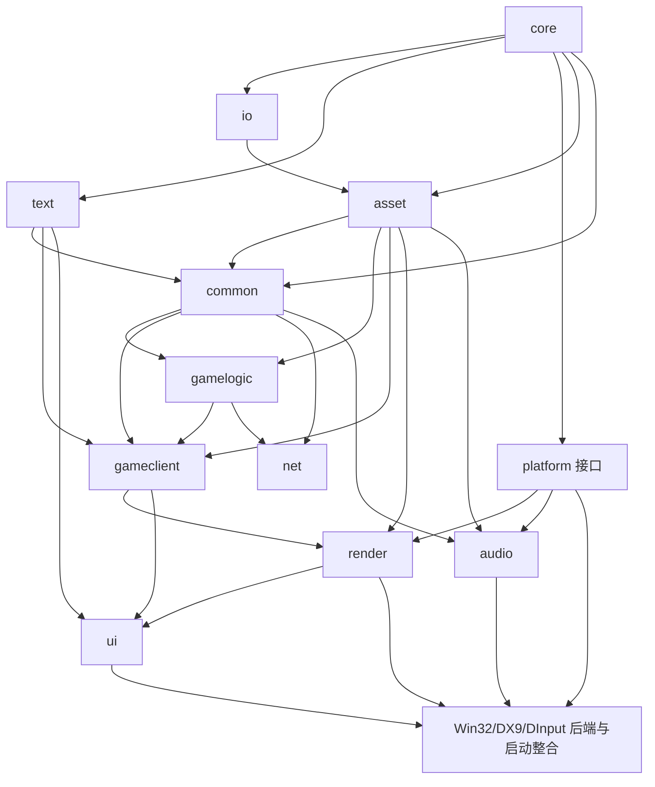

# RA3 模块映射、规模与重建顺序

> 本文的统计取自台账修正前的版本（48,982 行；当时断言里 `文件.cpp:行号` 形式的源路径没被识别，assetmanager 为 0 行）。修正后台账为 48,985 行，`asset` 9 行、`io` 31 行、`core` 13 行，数字待按新台账刷新。§6.1 列的 0x004479E0 已确认是 `ResourceManagerFileStream.cpp` 的校验和检查，见 `asset_system.md` §3.4。

## 1. 口径与证据等级

本文以 `function_ledger.tsv` 的 **48,982 行**、`source_file_functions.tsv` 的源码路径锚点、`source_paths.txt` 的恢复树、`vtables.tsv` 的 **2,977 个虚表候选**为基线；这些数量均为 **[实测]**。游戏文件只以只读方式扫描。

标记约定：

- **[实测-账本]**：直接统计台账字段。
- **[实测-二进制]**：只读扫描 `ra3_1.0.game` 得到。
- **[推断-邻近]**：把 `.text` 中 `module=unknown` 的函数分给距离不超过 `0x10000`（64 KiB）的最近源码锚点。距离相同取低地址锚点。该窗口用于近似 MSVC 按 `.obj` 链接后常见的局部连续性。
- **[参照]**：Generals/Zero Hour GPL 树中的结构类比；不能证明 RA3 实现相同。

邻近法只传播 `core/common/gamelogic/gameclient/net/render/audio/ui` 的 RA3 专属源码锚点；不使用遍布各模块的 EASTL `allocator.h`，也不跨过 64 KiB 强行填满地址空间。它为 **23,896** 个 `unknown` 给出候选归属，另有 **16,659** 个仍保持未知 **[推断-邻近]**。因此下文“估计数”适合排工作量，不是最终所有权。

直接调用数通过在台账所列 `.text` 函数范围内扫描 `E8 rel32` 并解析目标地址得到 **[实测-二进制]**。它不计虚调用、函数指针、尾调用和导入间接调用；误把嵌入数据当指令的风险因限定在函数范围内而降低，但未经过逐条反汇编确认。

## 2. 权威模块映射

Generals 路径默认相对于 `GeneralsMD\Code`；`Generals\Code` 有同构的较早版本，应以两树差异辅助判断演化。

| Ra3Source 模块 | RA3 恢复源码子树/证据 | Generals 对应目录与关键文件 | 边界与状态 |
|---|---|---|---|
| `core` | `Libraries\Source\ini\INI.cpp`、`string\{StringBase,UnicodeString}.cpp`、`debug\*`、`memorypool\lite_source\lite_memorypool.cpp` | `Libraries\Source\{ini,string,debug,memorypool}`；`GameEngine\Source\Common\System\{AsciiString,UnicodeString,MemoryPool}.cpp` | 配置、字符串、诊断、基础内存；已实现。 |
| `io` | `lib-packages\RtsBase\0.0-dev\source\file\cmn\{FileSystem,MemoryFile,RwFileWrapper,TextFile}.cpp`；rw::core filesystem/BigHandler/RefPack（字符串证据） | `GameEngine\Source\Common\System\{ArchiveFile,ArchiveFileSystem,StreamingArchiveFile}.cpp`；`GameEngineDevice\Source\Win32Device\Common\{Win32BIGFile,Win32BIGFileSystem,Win32LocalFile,Win32LocalFileSystem}.cpp` | 只读文件、BIG、RefPack；已实现。平台文件访问后端留给 `platform`。 |
| `text` | `SageEngine\source\GameEngine\gameclient\GameText.cpp`；发行数据 `gamestrings.csf` | `GameEngine\Source\GameClient\GameText.cpp` | CSF 与本地化查询；已实现。 |
| `asset` | `Libraries\Source\assetmanager\AssetList\{FullAssetList,FullAssetListPartial,PartialAssetList}.cpp`、`resourcemanager.cpp`、`Stream\ResourceManagerFileStream.cpp`、`AssetReferenceFixup.h`；`RtsXmlPipeline\ReloDetokenizers.h` | 无四件套的直接同物；边界参考 `Common\System\ArchiveFile*.cpp`，缓存/按需实例化参考 `GameEngineDevice\Source\W3DDevice\GameClient\{W3DAssetManager,W3DAssetManagerExposed}.cpp` | `.manifest/.bin/.relo/.imp/.cdata`；设计中，不能从 Generals 推导 RA3 记录布局。 |
| `common` | `SageEngine\source\GameEngine\common\audio\AudioEventRTS.cpp`、`GameStart.cpp`、`rts\{Player,PlayerList}.cpp`、`StateMachine.cpp`、`system\BuildAssistant.cpp`、`thing\{Thing,ThingTemplate}.cpp` | `GameEngine\Source\Common\Audio\AudioEventRTS.cpp`；`Common\RTS\{Player,PlayerList}.cpp`；`Common\System\{BuildAssistant,StateMachine}.cpp`；`Common\Thing\{Thing,ThingTemplate,Module,ModuleFactory}.cpp` | 跨客户端/逻辑共享的领域类型和模块工厂；未动工。 |
| `gamelogic` | `SageEngine\source\GameEngine\gamelogic`，恢复 116 个文件：`ai`、`dynamics`、`map`、`object\{Behavior,Contain,SpecialPower,Update,Weapon,WeaponEffects}`、`scriptengine`、`skirmishai`、`system` | `GameEngine\Source\GameLogic\AI`、`Map`、`Object`、`ScriptEngine`、`System`；关键文件 `Object.cpp`、`Weapon.cpp`、`GameLogic.cpp`、`ScriptEngine.cpp` | 确定性模拟、对象与 AI；未动工。 |
| `gameclient` | `SageEngine\source\GameEngine\gameclient`，恢复 21 个文件：`Drawable.cpp`、`FXList.cpp`、`GameSubTitles.cpp`、`input\Mouse.cpp`、`system\Anim2D.cpp`、`system\FXParticleSystem\*` 等 | `GameEngine\Source\GameClient\Drawable`、`Input`、`MessageStream`、`System`、`Terrain`；关键文件 `DrawableManager.cpp`、`Mouse.cpp`、`ParticleSys.cpp` | 非确定性客户端表现、输入语义、FX；未动工。 |
| `net` | `SageEngine\source\GameEngine\gamenetwork`：`GameSpy\Thread\{Buddy,Competition,Peer}Thread.cpp`、`GameSPYNATImpl.cpp`、`ReliableTransport.cpp`、`TickerDataHandler.cpp` | `GameEngine\Source\GameNetwork`；关键文件 `Network.cpp`、`Transport.cpp`、`Connection*.cpp`、`FrameData*.cpp`、`NetCommand*.cpp`、`GameSpy\Thread\*.cpp` | 帧同步、命令流、传输和旧 GameSpy 边界；未动工。 |
| `render` | `GameEngineDevice\W3DDevice\GameClient\{W3DDisplay,W3DView,WorldHeightMap,W3DRainManager,W3DTracerManager}.cpp`、`Drawable\W3D*Draw.cpp`、`posteffect\PostEffect.cpp`；`SageRender\source\Sage\Render\{Core,MaterialFactory,RenderObject,ShaderFactory}.cpp` | `GameEngineDevice\Source\W3DDevice\{Common,GameClient,GameLogic}`；`Libraries\Source\WWVegas\{WW3D2,WWMath,wwshade}`；关键文件 `W3DDisplay.cpp`、`W3DView.cpp`、`W3DScene.cpp`、`W3DShaderManager.cpp` | 渲染抽象、W3D 场景和 DX9 后端；未动工。 |
| `audio` | `GameEngineDevice\sageaudiodevice\AudioCache\SageAudioCache.cpp`、`PhysicalRenderingLayer\RenderingSound.cpp`、`SageAudioManager.cpp`；另有 rw::audio::core 字符串证据 | `GameEngine\Source\Common\Audio`；`GameEngineDevice\Source\MilesAudioDevice\MilesAudioManager.cpp`；`Libraries\Source\WWVegas\{WWAudio,Miles6}` | `common` 持有 AudioEvent 领域描述，`audio` 持有缓存、播放与设备后端；未动工。 |
| `ui` | `SageInGameUI\source\Sage\UI\Mouse\Tactical\UIImpl.cpp`、`ObjectActions.cpp`；Apt/EAStringC 导出接口 | `GameEngine\Source\GameClient\GUI`、`GameClient\InGameUI.cpp`；`GameEngineDevice\Source\W3DDevice\GameClient\W3DInGameUI.cpp` | 游戏 UI 编排与 Apt 适配；未动工。Apt 本体没有恢复出的具体源码路径。 |
| `platform` | 恢复树没有 Win32Device 路径；Win32/DInput/D3D 导入及窗口函数为程序证据 | `GameEngineDevice\Source\Win32Device\Common\Win32GameEngine.cpp`、`Win32OSDisplay.cpp`、`Win32LocalFile*.cpp`；`Win32Device\GameClient\{Win32Mouse,Win32DIMouse,Win32DIKeyboard}.cpp` | 当前不在 ledger 的 `module` 枚举中；建议把 OS 接口与具体 Win32/DX9 后端分开。未动工。 |

台账的非 Ra3Source 构建桶：

| ledger 值 | 含义 | 处理 |
|---|---|---|
| `thirdparty` | EASTL、OpenSSL、ATL/CRT 等 | **778 [实测-账本]**；优先替换为依赖或标准库，不逐函数重建。 |
| `securom` | `Stext/Sdata/.securom` 等保护代码 | **7,429 [实测-账本]**；不在重建范围。 |
| `unknown` | 尚无可靠归属 | 原始 **40,555 [实测-账本]**；邻近传播后暂余 **16,659 [推断-邻近]**。 |

## 3. 模块规模

“直接数”严格等于 ledger 的 `module` 列；`asset/io/text` 的 0 表示分类器没有标注，并不表示二进制中没有实现。“估计数”包含直接数和 64 KiB 邻近传播。

| 模块 | ledger 直接数 | 邻近新增 | 细化估计 | 可信度 |
|---|---:|---:|---:|---|
| `core` | 2 [实测] | 491 [推断] | **493 [推断]** | 低；仅两个 memorypool 锚点，且附近恰有大量保护入口，明显可能吸入启动/运行库代码。 |
| `io` | 0 [实测] | — | **未能估计** | 已知 0x004D1B60、0x009F5AF0–0x009F7620 等实现证据，但不来自源码路径锚点，不能据此划定整个对象区间。 |
| `text` | 0 [实测] | — | **未能估计** | `GameText.cpp` 路径无函数锚点；模块已由数据格式重建，不应把 0 当规模。 |
| `asset` | 0 [实测] | — | **未能估计** | 六个 assetmanager 路径均无函数锚点；只找到局部四件套交叉引用。 |
| `common` | 9 [实测] | 1,661 [推断] | **1,670 [推断]** | 中低；5.5M、7.9M、8.0M 三个稀疏簇。 |
| `gamelogic` | 158 [实测] | 12,581 [推断] | **12,739 [推断]** | 中；锚点最多且覆盖 6.7M–8.9M 多个密集簇，但仍可能混入邻接模块。 |
| `gameclient` | 25 [实测] | 3,430 [推断] | **3,455 [推断]** | 中低；锚点分散于多个代码簇。 |
| `net` | 2 [实测] | 1,091 [推断] | **1,093 [推断]** | 低；只有两个锚点。 |
| `render` | 15 [实测] | 1,963 [推断] | **1,978 [推断]** | 中低；W3D 锚点较清楚，但 SageRender/WW3D 边界未锚定。 |
| `audio` | 7 [实测] | 535 [推断] | **542 [推断]** | 中低；三个具体文件有锚点，rw::audio 区域未覆盖。 |
| `ui` | 2 [实测] | 2,144 [推断] | **2,146 [推断]** | 低；两个锚点相距约 3.8 MiB，Apt 与 UI 很可能混在估计中。 |
| `platform` | 不在枚举 [实测] | — | **未能估计** | 只能由导入/API 使用识别局部入口。 |

对账：八个可传播模块合计 **24,116**（其中直接 220、推断新增 23,896），加未归属 16,659、`thirdparty` 778、`securom` 7,429，恰为 **48,982 [实测+推断对账]**。这说明统计没有漏行，不说明传播归属正确。

## 4. 依赖图与重建顺序

建议自底向上顺序：

1. **基线：`core → io → text`**，三者已完成 **[实测-仓库]**。
2. **`platform` 的窄接口 + `asset`**：先冻结文件、窗口、时钟、输入、图形/音频设备接口；随后完成四件套目录、重定位、导入与 registry。具体 Win32 后端仍可延后。
3. **`common`**：Thing/ThingTemplate、Module、StateMachine、Player、AudioEvent 等共享模型。
4. **`gamelogic`**：先 GameLogic/Object/Weapon，再 ScriptEngine、地图、AI；以固定 tick 和可序列化状态为约束。
5. **`net`**：建立在确定性逻辑与命令序列化之上；离线 transport/mock 可先行。
6. **`gameclient`**：Drawable、FX、粒子、客户端状态和输入语义。
7. **`audio` 与 `render`**：audio 可在 common+asset 后并行；render 在 Drawable/asset 身份稳定后推进。
8. **`ui`**：先 ObjectActions/UI 状态，再接 Apt；依赖 text、gameclient 和 render。
9. **Win32/DX9/DInput/Miles 后端与启动整合**：最后把 platform 实现、主循环和各设备模块接通。

关键防环规则：`common` 只定义 AudioEvent/Thing 等抽象，不能依赖 `audio/render/ui`；`asset` 只提供稳定身份与原始/类型化视图，不能依赖消费资源的游戏模块；`platform` 接口不包含游戏领域对象。

## 5. SecuROM 影响

下表把保护状态随同 64 KiB 邻近归属传播。`entry-lost` 和 `inner-patched` 是用户要求的主指标；其余状态用于核对。

| 模块 | 估计总数 | entry-lost | inner-patched | entry-recoverable | patched | 判断 |
|---|---:|---:|---:|---:|---:|---|
| `core` | 493 | 128 | 9 | 10 | 0 | 数字高但可信度低，极可能把受保护启动区误归到 memorypool。 |
| `common` | 1,670 | 4 | 27 | 3 | 0 | 中等。 |
| `gamelogic` | 12,739 | **188** | **186** | 37 | 2 | 绝对数量最高，重建风险最高且结论相对最可信。 |
| `gameclient` | 3,455 | 2 | **49** | 6 | 1 | 以中间补丁为主。 |
| `net` | 1,093 | 0 | 32 | 10 | 0 | 无入口丢失被分到锚点窗口，但锚点太少。 |
| `render` | 1,978 | 1 | 30 | 6 | 0 | 中间补丁为主。 |
| `audio` | 542 | 0 | 29 | 2 | 0 | 中间补丁占比偏高。 |
| `ui` | 2,146 | 0 | 0 | 0 | 1 | “几乎无影响”不可靠，两个锚点无法覆盖 Apt。 |
| 仍未知 | 16,659 | **330** | 63 | 47 | 4 | 最大未决风险池。 |

合计恰为 ledger 的 `entry-lost=653`、`inner-patched=425`、`entry-recoverable=121`、`patched=8` **[实测-账本；模块分配为推断]**。实际排期应优先把 gamelogic 的 188 个入口丢失函数按调用者/虚表归类；不要据 `core` 的 128 直接认定现有 core 重建受同等影响。

## 6. 未动工模块的切入函数

表中“锚定”表示台账已有具体 RA3 源文件；“邻近”表示函数本身无 `source_file`，文件名由最近锚点推断；“语义”表示由字符串或导入 API 识别。全部候选均为 `securom=clean` **[实测-账本]**。

### 6.1 asset

assetmanager 在台账中为 0 行，以下是只读扫描的局部突破口，不是源码锚定。0x004479E0 同时直接引用 `.relo` 和 `.imp` 字符串 **[实测-二进制]**。

| 地址 | ledger 名 | E8 入边 | 建议源文件 | 依据 |
|---|---|---:|---|---|
| `0x004479E0` | `FUN_004479e0` | 1 | `Libraries\Source\assetmanager\resourcemanager.cpp`（推断） | 直接引用 `.relo`、`.imp`；优先分析四件套打开/分派。 |
| `0x00447D70` | `FUN_00447d70` | 0 | 同上（推断） | 直接调用 0x004479E0；适合恢复上层参数和返回语义。 |
| `0x00447E30` | `FUN_00447e30` | 1 | 同上或 `Stream\ResourceManagerFileStream.cpp`（推断） | 与前两者地址连续。 |
| `0x00448530` | `FUN_00448530` | 1 | 同上（低可信推断） | 邻近 clean 函数；需先验证是否仍在同一 `.obj`。 |

### 6.2 common

| 地址 | ledger 名 | E8 入边 | RA3 源文件 |
|---|---|---:|---|
| `0x0055B5E0` | `FUN_0055b5e0` | 9 | `common\audio\AudioEventRTS.cpp`（锚定） |
| `0x00556FF0` | `FUN_00556ff0` | 8 | `common\system\BuildAssistant.cpp`（锚定） |
| `0x0055B6F0` | `FUN_0055b6f0` | 6 | `common\audio\AudioEventRTS.cpp`（锚定） |
| `0x0055A7A0` | `FUN_0055a7a0` | 5 | `common\audio\AudioEventRTS.cpp`（锚定） |

切入要点：先恢复 AudioEvent 值对象/解析边界和 BuildAssistant 的查询接口；避免一开始进入 Player/Thing 的大对象图。

### 6.3 gamelogic

| 地址 | ledger 名 | E8 入边 | RA3 源文件 |
|---|---|---:|---|
| `0x008684C0` | `FUN_008684c0` | 15 | `gamelogic\map\TerrainLogic.cpp`（锚定） |
| `0x006A7AE0` | `FUN_006a7ae0` | 13 | `gamelogic\object\ObjectCreationList.cpp`（锚定） |
| `0x008BE710` | `FUN_008be710` | 10 | `gamelogic\skirmishai\AIMicroManager\AIMicroManager.cpp`（锚定） |
| `0x008B15D0` | `FUN_008b15d0` | 9 | 同上（锚定） |
| `0x00859770` | `FUN_00859770` | 6 | `gamelogic\scriptengine\ScriptEngine.cpp`（锚定） |

切入要点：TerrainLogic 与 OCL 能先形成小而可测的查询/创建边界；ScriptEngine 可建立脚本宿主接口；AI 两个高入边函数适合在核心对象模型稳定后进入。

### 6.4 gameclient

| 地址 | ledger 名 | E8 入边 | RA3 源文件 |
|---|---|---:|---|
| `0x00538530` | `FUN_00538530` | 91 | `gameclient\FXList.cpp`（锚定） |
| `0x00873F80` | `FUN_00873f80` | 5 | `drawable\Behavior\RandomSoundSelectorClientBehavior.cpp`（锚定） |
| `0x0051FCB0` | `FUN_0051fcb0` | 4 | `gameclient\Drawable.cpp`（锚定） |
| `0x00929C40` | `FUN_00929c40` | 3 | `SkirmishAISupport\SkirmishAIInTroubleMonitor.cpp`（锚定） |
| `0x00665C40` | `FUN_00665c40` | 3 | `system\FXParticleSystem\fxpsemittervolumemodule.cpp`（锚定） |

切入要点：0x00538530 的静态调用覆盖显著最高，适合先确定 FXList 的公共调度；Drawable 建立逻辑对象到表现对象的边界；粒子模块可作为纯数据转换测试。

### 6.5 net

只有两个直接源码锚点，后三项的源文件是地址邻近推断。

| 地址 | ledger 名 | E8 入边 | RA3 源文件 |
|---|---|---:|---|
| `0x005E6D20` | `FUN_005e6d20` | 3 | `gamenetwork\GameSPYNATImpl.cpp`（锚定） |
| `0x005D7A00` | `FUN_005d7a00` | 1 | `gamenetwork\TickerDataHandler.cpp`（锚定） |
| `0x005D5AE0` | `FUN_005d5ae0` | 85 | `TickerDataHandler.cpp`（邻近 `0x1F20`） |
| `0x005EACE0` | `FUN_005eace0` | 57 | `GameSPYNATImpl.cpp`（邻近 `0x3FC0`） |
| `0x005EAB60` | `FUN_005eab60` | 46 | `GameSPYNATImpl.cpp`（邻近 `0x3E40`） |

切入要点：先验证三个高入边邻近函数是否真与两个锚点同 `.obj`；若成立，可先抽离 ticker 数据编码，再把 GameSpy NAT 封装成可替换的旧服务适配器。

### 6.6 render

| 地址 | ledger 名 | E8 入边 | RA3 源文件 |
|---|---|---:|---|
| `0x0090CE30` | `FUN_0090ce30` | 4 | `W3DDevice\GameClient\Drawable\W3DScriptedModelDraw.cpp`（锚定） |
| `0x00908420` | `FUN_00908420` | 2 | 同上（锚定） |
| `0x008F7990` | `FUN_008f7990` | 1 | `Drawable\W3DSpotlightDraw.cpp`（锚定） |
| `0x008E8A00` | `FUN_008e8a00` | 1 | `Drawable\W3DScriptedModelDraw.cpp`（锚定） |
| `0x008E52B0` | `FUN_008e52b0` | 1 | `Drawable\W3DDynamicsDraw.cpp`（锚定） |

切入要点：先恢复 Draw 模块输入和资源句柄，不立即复刻 DX9 状态机；把模型脚本、聚光灯和动力学数据转换做成可记录的渲染命令。

### 6.7 audio

| 地址 | ledger 名 | E8 入边 | RA3 源文件 |
|---|---|---:|---|
| `0x005161C0` | `FUN_005161c0` | 5 | `sageaudiodevice\SageAudioManager.cpp`（锚定） |
| `0x00504BB0` | `FUN_00504bb0` | 4 | `AudioCache\SageAudioCache.cpp`（锚定） |
| `0x0051D3C0` | `FUN_0051d3c0` | 3 | `SageAudioManager.cpp`（锚定） |
| `0x00515B70` | `FUN_00515b70` | 1 | `PhysicalRenderingLayer\RenderingSound.cpp`（锚定） |
| `0x0051E560` | `FUN_0051e560` | 0 | `SageAudioManager.cpp`（锚定；可能经虚调用） |

切入要点：先确定 manager→cache→rendering sound 的请求流，用空设备验证生命周期；零 E8 入边不等于不可达，需结合虚表。

### 6.8 ui

后三项都距 `ObjectActions.cpp` 锚点不足 `0x1300`，比本章通用 64 KiB 窗口更强，但仍需反编译确认。

| 地址 | ledger 名 | E8 入边 | RA3 源文件 |
|---|---|---:|---|
| `0x00A78C00` | `FUN_00a78c00` | 4 | `SageInGameUI\source\Sage\UI\ObjectActions.cpp`（锚定） |
| `0x00AB47D0` | `FUN_00ab47d0` | 0 | `SageInGameUI\source\Sage\UI\Mouse\Tactical\UIImpl.cpp`（锚定） |
| `0x00A77AE0` | `FUN_00a77ae0` | 140 | `ObjectActions.cpp`（邻近 `0x1120`） |
| `0x00A79E90` | `FUN_00a79e90` | 125 | `ObjectActions.cpp`（邻近 `0x1290`） |
| `0x00A78020` | `FUN_00a78020` | 106 | `ObjectActions.cpp`（邻近 `0x0BE0`） |

切入要点：先验证三个高入边函数是否为 ObjectActions 的小型查询/调度，再恢复 tactical UI；Apt 导出接口应单独建 ABI 清单。

### 6.9 platform

platform 没有 RA3 源码路径锚点。下列候选由原始 IAT 槽的静态引用确定 **[实测-二进制]**，建议源文件仅是 Generals 同构类比 **[参照+推断]**。Windows 回调和主循环常通过函数指针/系统入口到达，E8 入边为 0 不意外。

| 地址 | ledger 名 | E8 入边 | 使用的 API | 建议源文件 |
|---|---|---:|---|---|
| `0x004017B0` | `FUN_004017b0` | 0 | `RegisterClassW`、`CreateWindowExW`、`ShowWindow`、`UpdateWindow` | `Win32Device\Common\Win32GameEngine.cpp`（推断） |
| `0x005036D0` | `FUN_005036d0` | 0 | `PeekMessageA`、`TranslateMessage`、`DispatchMessageA`、`GetMessageA` | `Win32GameEngine.cpp`（推断） |
| `0x00504390` | `FUN_00504390` | 0 | `PeekMessageA`、`TranslateMessage`、`DispatchMessageA` | `Win32GameEngine.cpp`（推断） |
| `0x00511F60` | `FUN_00511f60` | 0 | `DefWindowProcW/A` | `Win32Device\Common\Win32OSDisplay.cpp`（推断） |

切入要点：先恢复窗口创建、消息泵和窗口过程之间的控制流，再定义最小 platform 接口；D3D9/DInput 的 IAT thunk 只是导入跳板，不作为重建函数。

## 7. 把握程度与下一步

高把握：

- ledger 总数、直接模块数、保护状态总数、2,977 个虚表候选；
- 191 个恢复源码路径及概览第 6 节给出的子树文件数；
- 所有“锚定”函数的地址、源文件、`clean` 状态；
- `.relo/.imp` 对 0x004479E0 的静态引用，以及 platform 候选使用的 Win32 API；
- E8 统计的定义和扫描范围。

推断：

- 64 KiB 邻近传播后的模块规模及其 SecuROM 分模块数字；
- `asset` 四个候选中除字符串交叉引用之外的具体职责和源文件；
- net/ui 的邻近候选源文件；
- platform 候选对应哪个 RA3 `.cpp`；
- Generals 目录仅能提供结构、接口和命名参照，不能证明 RA3 字段布局或行为。

优先补证顺序：先反编译 asset 的 0x004479E0 调用链；再对 net/ui 高入边邻近候选确认 `.obj` 边界；随后把 2,977 个虚表按构造函数写入点归类。每增加一个可靠源码/类锚点，都应重新运行邻近统计并缩小或拆分窗口，而不是把本版估计固化为事实。
